# Assignment 3 — Responsive Web Design

**Name:** Berdalin Yerbol  
**Group:** IT-2513

This project develops my Assignment 2 ErbaPortfolio. It keeps the original projects, descriptions, images and dark blue / light gray design, and adds responsive typography, CSS media queries, Bootstrap Grid and a collapsing navbar. Assignment 2 is preserved separately.

## Run and files

This is a static HTML/CSS project: no build step or package installation is required. Bootstrap 5.3.8 CSS and its JavaScript bundle load from jsDelivr, so internet access is required for Bootstrap styles and the hamburger menu.

- `index.html`: portfolio, Tasks 3–4.
- `media-queries.html` + `media-queries.css`: Tasks 0–1, without any Bootstrap CSS or JavaScript.
- `bootstrap-demo.html`: Task 2, plus shared Task 3 navbar.
- `style.css`: custom portfolio and Bootstrap demo styles, loaded after Bootstrap.
- `images/`: original project images and technology icons.

## Screen sizes

| Screen | Width | Columns in Tasks 1–2 | Task 0 h1 / h2 / paragraph |
| --- | --- | --- | --- |
| Mobile | below 768 px | 1 | 28 / 22 / 16 px |
| Tablet | 768–991 px | 2, then the third box on the next row | 32 / 26 / 18 px |
| Desktop | 992 px and above | 3 | 36 / 30 / 20 px |

These thresholds are implementation choices matching Bootstrap `md` and `lg`; the assignment does not prescribe exact values.

## Part 1 — Media Queries

### Task 0 — Responsive Typography

`media-queries.html#typography`: Headings and paragraphs use small mobile font sizes by default. The two `min-width` media queries increase their sizes on tablet and desktop. No framework is loaded.

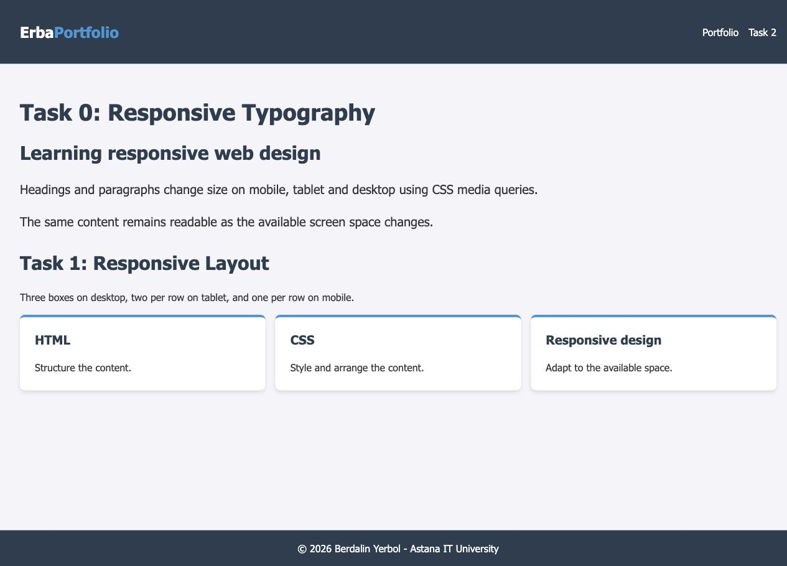

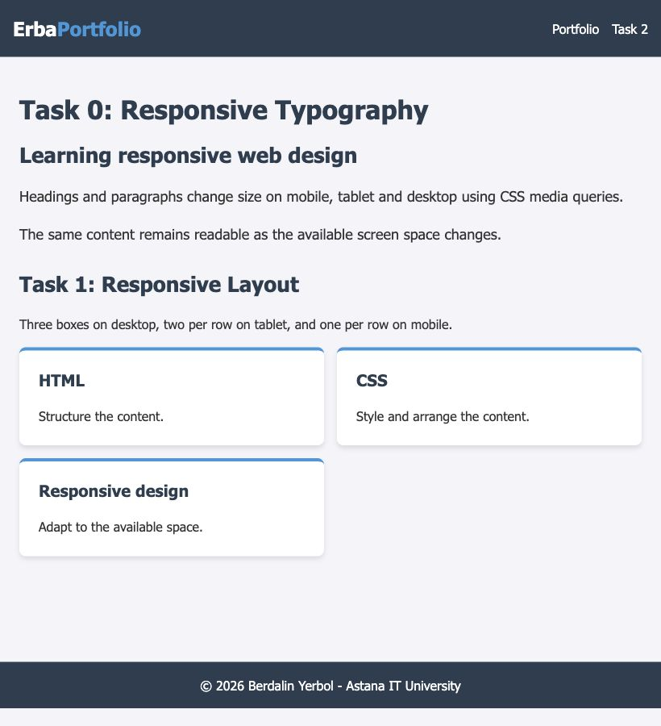

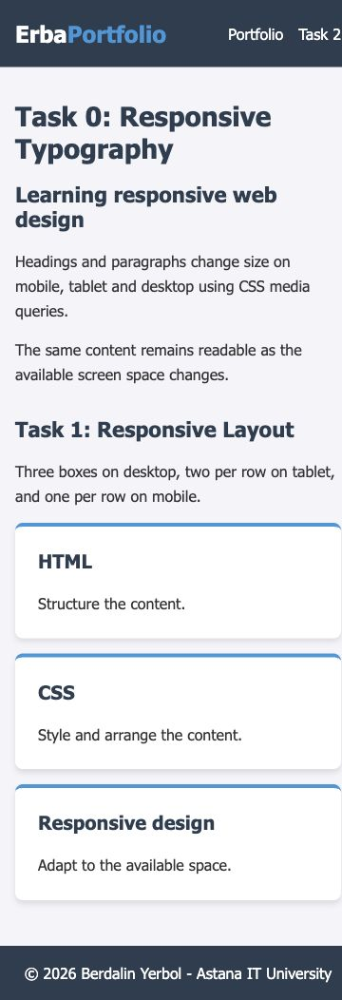

### Task 1 — Responsive Layout with Media Queries

`media-queries.html#boxes`: Exactly three boxes use native CSS Grid. The default `grid-template-columns: 1fr` stacks them. At 768 px, `repeat(2, minmax(0, 1fr))` creates two columns; at 992 px, `repeat(3, minmax(0, 1fr))` creates three. Media queries control all layout changes; this page has no Bootstrap dependency.

## Part 2 — Bootstrap Grid System

### Task 2 — Bootstrap Responsive Columns

`bootstrap-demo.html`: Exactly three columns are children of a Bootstrap `.row`. Each uses `col-12 col-md-6 col-lg-4`: 12/12 of a row on mobile, 6/12 on tablet, 4/12 on desktop. `g-4` supplies equal gutters. The third column naturally wraps onto the second row on tablet.

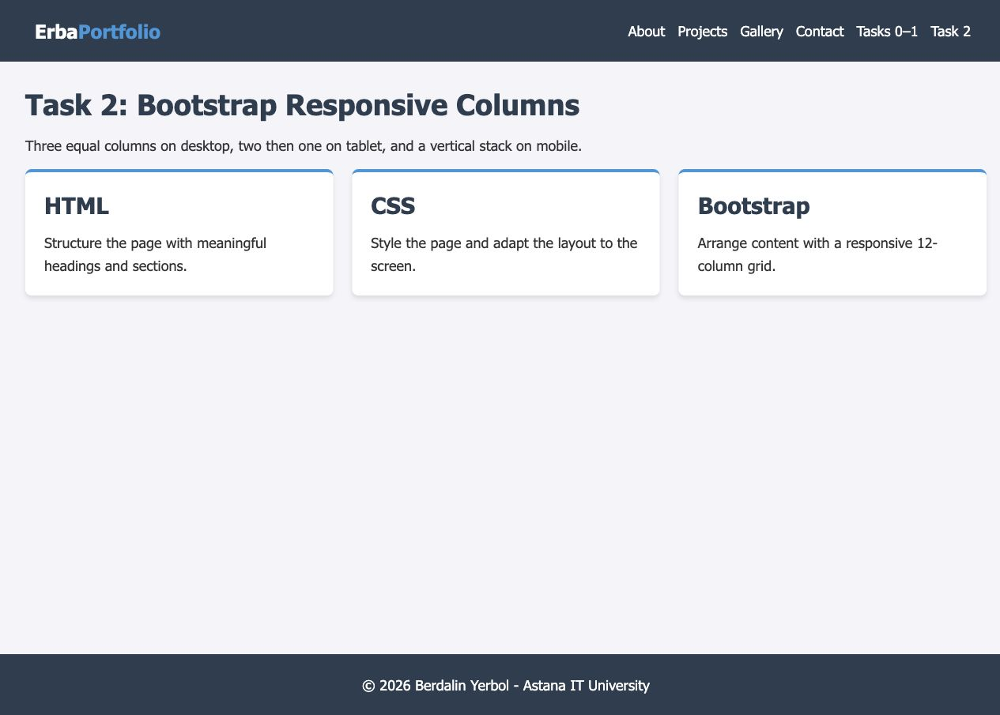

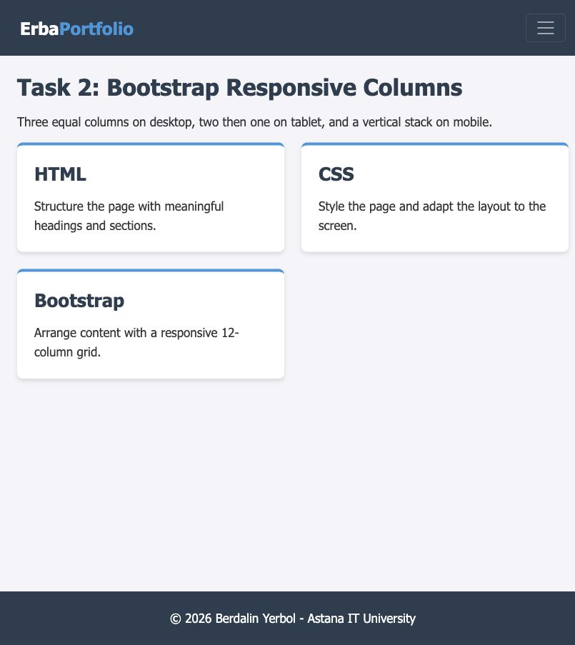

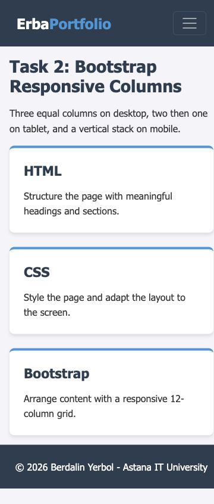

### Task 3 — Bootstrap Navigation Bar

The portfolio and Bootstrap demo share a `navbar navbar-expand-lg` header. The brand is left, `.ms-auto` places navigation on the right when expanded. Below 992 px, the toggler uses `data-bs-toggle="collapse"` and `data-bs-target="#mainMenu"`. Bootstrap's JavaScript bundle opens/closes that element and manages `aria-expanded`. The button has an accessible label. Portfolio anchors and links to all demo pages are provided.

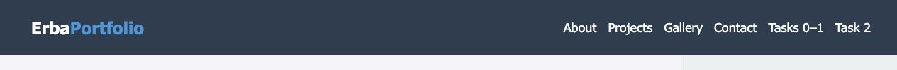

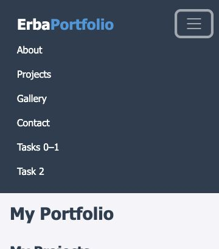

## Part 3 — Combined Project

### Task 4 — Responsive Portfolio Page

`index.html`: The header contains the Bootstrap navbar. On desktop, a Bootstrap row divides the main projects area (`col-lg-9`) on the left from the personal sidebar (`col-lg-3`) on the right. Below 992 px they stack with projects first. Project cards use Bootstrap `col-12 col-md-6 col-lg-4` wrappers, with Flexbox inside each card for aligned content and links. The footer spans the page bottom.

Custom media queries increase heading/body sizes and section padding for tablet/desktop. `.desktop-note` is visible on desktop and hidden at smaller sizes; essential content remains available. The retained technology gallery uses one/two/three CSS columns and `grid-auto-rows` so every row has consistent height. Logos use `object-fit: contain` to avoid cropping. Gallery captions remain visible on touch devices and reveal on hover on devices supporting hover. Reduced-motion users receive no custom card/image animation.

The original project links are preserved.

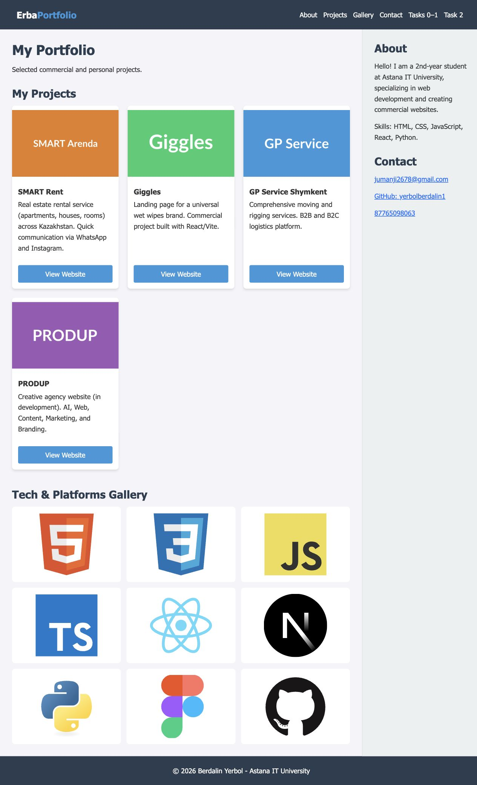

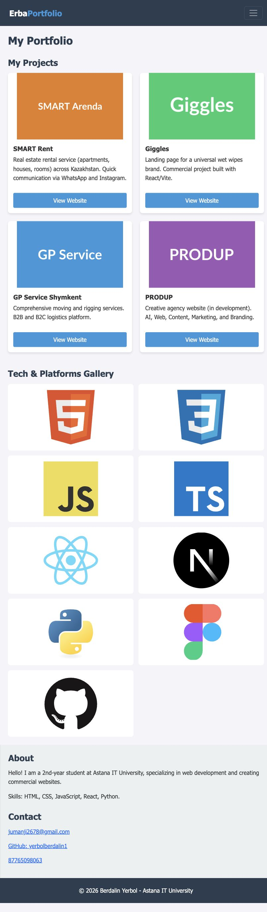

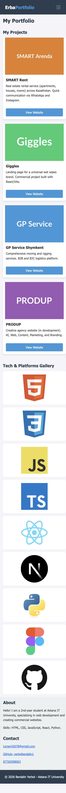

## Work process

1. Read the Assignment 3 requirements and inspected the previous portfolio.
2. Preserved the project content and visual palette in a separate project.
3. Separated the pure CSS exercises from the Bootstrap pages.
4. Added Bootstrap Grid and Collapse, then custom typography, spacing and visibility media queries.
5. Checked local file references, image paths, HTML structure and task-specific source patterns. All source assets were copied without changing Assignment 2.

## Resources for defense

- Abitova G.A., *Web technologies Front-End Development. Part 1* (2022).
- [Course playlist](https://www.youtube.com/playlist?list=PLPT6CF0r4E3rkvy1rLUKdDHf_HmWZeURW).
- [Bootstrap introduction](https://getbootstrap.com/docs/5.3/getting-started/introduction/).
- [W3Schools media queries](https://www.w3schools.com/css/css_rwd_mediaqueries.asp).
- [MDN responsive design](https://developer.mozilla.org/en-US/docs/Learn_web_development/Core/CSS_layout/Responsive_Design).

